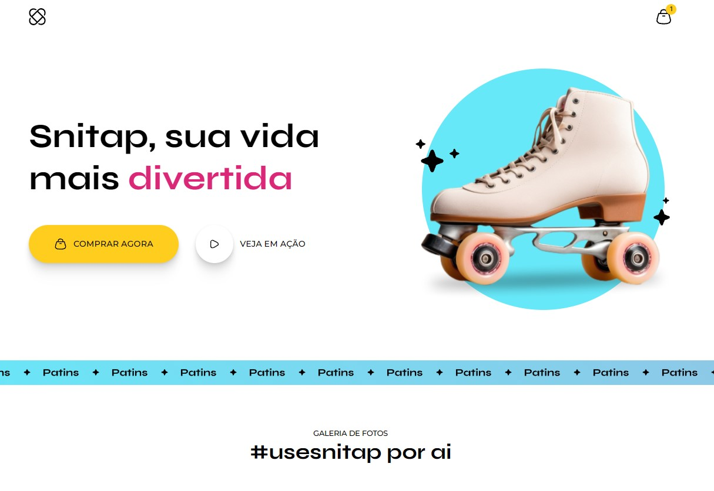

# Snitap Patins

<!-- Substitua o caminho abaixo pela imagem de preview do projeto -->
<p align="center">
  
</p>

## Acesso ao projeto

🔗 **Link:** [Acesse o projeto](https://lucas072-cpu.github.io/patins-animation/)

Landing page criada para treinar animações em CSS. O projeto apresenta uma interface inspirada no universo dos patins, com textos animados, elementos em movimento, galeria interativa e banner em looping.

## Tecnologias utilizadas

- **HTML5**: estrutura semântica da página
- **CSS3**: estilização dos componentes e layouts
- **CSS Grid**: organização da galeria de fotos
- **Flexbox**: alinhamento dos cabeçalhos, cartões e componentes
- **CSS Animations**: animações com `@keyframes`
- **CSS Transitions**: efeitos de hover e transições suaves
- **CSS Nesting**: organização dos estilos com regras aninhadas
- **CSS Scroll-driven Animations**: entrada animada das imagens com `animation-timeline: view()`
- **Variáveis CSS**: paleta de cores, fontes e tamanhos de texto
- **Google Fonts**: Montserrat, Syne e Inter
- **Live Server**: execução local durante o desenvolvimento

## Funcionalidades e animações

- Textos em destaque alternados verticalmente
- Entrada animada dos elementos do hero
- Botões com efeitos de escala e sombra
- Banner infinito com gradiente animado
- Ícones do cabeçalho com efeito de giro
- Galeria em grid com zoom e legenda ao passar o mouse
- Animações acionadas conforme os elementos entram na tela
- Rodapé com links e redes sociais animados

## Estrutura do projeto

```text
patins-animation/
├── assets/
│   ├── hero/
│   ├── icons/
│   └── images/
├── styles/
│   ├── index.css
│   ├── global.css
│   ├── header.css
│   ├── hero.css
│   ├── banner.css
│   ├── gallery.css
│   └── footer.css
└── index.html
```
